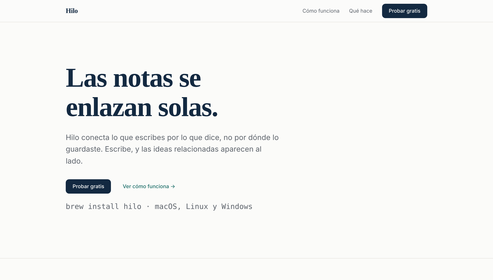

<div align="center">


<br>

[](LICENSE)
[](CHANGELOG.md)
[](https://github.com/VemorisSoftware)

**Folio hace que las páginas web se vean diseñadas con intención, no genéricas.**
No es una plantilla: es un **criterio**.

</div>

---

Le das a tu agente (Claude Code, Codex…) el gusto para maquetar una página con
una **dirección clara**, jerarquía real, movimiento sobrio y aire — y para
**revisarla en un navegador de verdad** hasta que quede bien. Funciona con HTML
puro, React, Vue, Svelte o Astro: Folio trata del diseño, no del framework.

<div align="center">


<sub>**Producto / tech** — hero oscuro, titular serif enorme, mockup con luz, diagrama y cifras que cuentan solas.</sub>

<br><br>



<sub>**Editorial sereno** — la misma skill, otra voz. Las dos pasan la revisión en 4 anchos.</sub>

</div>

## Instalar

Necesitas **Node 22+** y **Chrome, Edge o Chromium** instalado (para la revisión
en navegador; define `CHROME_PATH` si está en una ruta rara). Sin API keys ni cuentas.

```sh
git clone https://github.com/VemorisSoftware/folio
cd folio && npm install && ./install.sh        # --codex o --all-agents
```

Luego, en tu proyecto web, pídele a tu agente:

> «Rediseña la portada con Folio» · «Construye una landing para … usando Folio»

El agente lee `SKILL.md` y sigue el proceso.

## Cómo funciona

1. **Entender** qué es la página y su **tipo** (`producto`, `servicio`, `lugar`, `editorial`, `portafolio`).
2. **Repartir el sistema** — paleta + tipografía coherentes, con contraste AA comprobado.
3. **Elegir una dirección de arte** — una sola, de 14.
4. **Construir con contenido real** — nada de relleno; fotos con licencia libre y crédito; movimiento sobrio.
5. **Revisar y cerrar** — abre la página en 4 anchos, revisa, y no deja pasar una FALLA.

## Las herramientas

Scripts de verdad (Node + Chrome, sin APIs). Un comando: `node scripts/folio.mjs <cmd>`.

| Comando | Qué hace |
|---|---|
| `sistema --tipo <tipo>` | Reparte paleta + tipografía y escribe los `<link>` y tokens `:root`. |
| `direccion --tipo <tipo>` | Reparte una dirección de arte (evita las recientes). |
| `fotos "<búsqueda>"` | Busca imágenes con licencia libre (Openverse) y arma el crédito. |
| `revisar <url\|archivo>` | Abre la página en 4 anchos y revisa desborde, un solo H1, contraste AA, ancho de línea, nº de tipografías, `alt` y toque en móvil. |
| `textos <archivo>` | Linter: caza «Lorem ipsum», frases de molde, testimonios de relleno y marcadores. |
| `cierre <url\|archivo>` | La puerta de cierre: textos + revisión. No pasa con FALLAS. Sirve como hook de Stop. |

## Movimiento

Un módulo propio, **sin librerías** (`assets/folio-motion.js`): el mismo «feel» de
las buenas webs — scroll suave, apariciones al bajar y parallax — pero ligero.
Un `<script>` y marcas con data-atributos:

```html
<h1 data-folio="entrada">…</h1>                            <!-- entra al cargar -->
<section data-folio="aparece">…</section>                 <!-- aparece al bajar -->
<div data-folio="parallax" data-velocidad="0.15">…</div>  <!-- parallax sutil -->
<b data-folio="contador" data-fin="12000" data-sufijo="M">0</b> <!-- cuenta solo -->
```

Para scroll suave tipo mantequilla: `Folio.motion({ scrollSuave: true })`. Todo se
apaga con `prefers-reduced-motion`.

## Las 14 direcciones de arte

| | | | |
|---|---|---|---|
| **Editorial sereno** | **Monolito** | **Índice** | **Terminal** |
| **Galería** | **Dividido** | **Centrado** | **Producto** |
| **Foto** | **Collage** | **Palabra** | **Declaración** |
| **Tríptico** | **Panel** | | |

Cada una dice cuándo usarla y cómo maquetarla en `direcciones/`.

## Con tu propia marca

Folio trae un sistema por defecto (cálido, editorial, sobrio), pero **las
direcciones, el movimiento y la revisión valen para cualquier identidad**.
Reemplaza los tokens de color y las dos tipografías por los de tu marca
(respetando los roles: un fondo tranquilo, una voz, un acento con avaricia) y el
gusto de Folio se mantiene. Detalle en `sistema/tokens.md`.

## Preguntas frecuentes

**¿Necesita internet o una cuenta?** No. Solo `folio fotos` usa la red, y únicamente
para buscar imágenes en Openverse. Tu código nunca sale de tu equipo.

**¿Con qué frameworks funciona?** HTML, React, Vue, Svelte, Astro, Tailwind.

**¿Qué navegador usa la revisión?** El Chrome/Chromium que ya tengas, headless.
Define `CHROME_PATH` si está en una ruta no estándar.

**¿Puede rediseñar una página que ya existe?** Sí: `folio revisar <url>` y pídele al
agente que arregle lo que salga.

## Filosofía, en tres reglas

1. Una sola idea manda por pantalla.
2. La tipografía hace el trabajo pesado.
3. El color se usa con avaricia.

<div align="center">
<br>

Software libre (MIT) de **Vemoris Software**. Hecho con cuidado.

</div>
