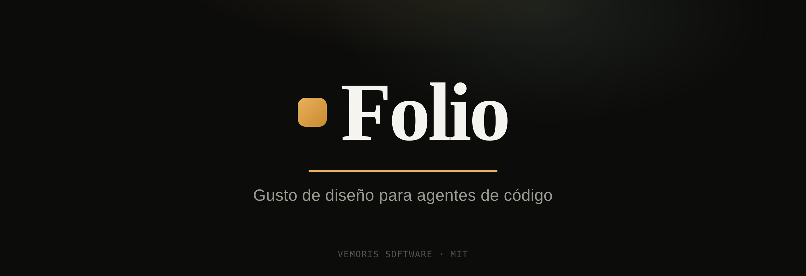

<p align="center">
  <picture>
    <source media="(prefers-color-scheme: dark)" srcset="assets/wordmark-dark.png">
    
  </picture>
</p>

<p align="center">
  <a href="https://github.com/VemorisSoftware/folio"></a>
  <a href="CHANGELOG.md"></a>
  <a href="LICENSE"></a>
  <a href="https://github.com/VemorisSoftware"></a>
</p>

<p align="center">
  
</p>

**Folio** (`folio 0.3.0`) : una skill de gusto de diseño para agentes de código. Le da a tu agente (Claude Code, Codex…) el criterio para maquetar una página con una dirección clara, jerarquía real, movimiento sobrio y aire — y para revisarla en un navegador de verdad hasta que quede bien. No es una plantilla: es un criterio. Funciona con HTML, React, Vue, Svelte o Astro, porque trata del diseño, no del framework.

Páginas construidas con Folio desde un solo encargo:

<table>
  <tr>
    <td width="50%"><br><sub><b>Producto / tech</b> — hero oscuro, mockup con luz, diagrama y cifras que cuentan solas.</sub></td>
    <td width="50%"><br><sub><b>Editorial sereno</b> — la misma skill, otra voz.</sub></td>
  </tr>
</table>

<sub>Las dos pasan la revisión en 4 anchos. Las fotos de bancos con licencia libre se buscan con <code>folio fotos</code> y llevan su crédito.</sub>

## Install

```bash
npx skills add VemorisSoftware/folio
```

Instala Folio como skill en tu agente de código. Volver a correr el mismo comando la actualiza.

Necesitas **Node 22+** y **Chrome, Edge o Chromium** instalado (para la revisión en navegador; define `CHROME_PATH` si está en una ruta no estándar). Sin API keys ni cuentas.

<details>
<summary>Claude Code</summary>

```sh
/plugin marketplace add VemorisSoftware/folio
/plugin install folio@folio
```
</details>

<details>
<summary>Codex</summary>

```sh
codex plugin marketplace add VemorisSoftware/folio
codex plugin add folio@folio
```
</details>

<details>
<summary>Desde un clon, enlazado en vez de copiado</summary>

```sh
git clone https://github.com/VemorisSoftware/folio
cd folio && npm install && ./install.sh      # --codex o --all-agents
```
Al ser un enlace, un `git pull` deja Folio actualizado.
</details>

## How it works

Folio le da al agente un proceso de 5 pasos. En tu proyecto, le pides «rediseña la portada con Folio» y sigue esto:

1. **Entiende la página y su tipo.** La clasifica en `producto`, `servicio`, `lugar`, `editorial` o `portafolio`, lo que decide los materiales.
2. **Reparte un sistema.** `sistema` le da una paleta y una pareja tipográfica coherentes, con contraste AA comprobado, y evita repetir las de builds recientes.
3. **Elige una dirección de arte.** Una sola, de 14. Cada una dice cómo maquetar; no se mezclan dos.
4. **Construye con contenido real.** Nada de relleno ni cajas grises; fotos con licencia libre y crédito; movimiento sobrio con el módulo propio.
5. **Revisa en un navegador real.** `cierre` abre la página en 4 anchos y no deja pasar una FALLA de jerarquía, contraste o móvil.

Lo que cambia entre versiones está en el [registro de cambios](CHANGELOG.md).

## The tools

Scripts de verdad (Node + Chrome, sin APIs). Un comando: `node scripts/folio.mjs <cmd>`.

| Herramienta | Qué hace |
| --- | --- |
| `sistema --tipo <tipo>` | Reparte paleta + tipografía y escribe los `<link>` y tokens `:root`. |
| `direccion --tipo <tipo>` | Reparte una dirección de arte (evita las recientes). |
| `fotos "<búsqueda>"` | Busca imágenes con licencia libre (Openverse) y arma el crédito. |
| `revisar <url\|archivo>` | Abre la página en 4 anchos: desborde, un solo H1, contraste AA, línea, tipografías, `alt`, toque móvil. |
| `textos <archivo>` | Linter: caza «Lorem ipsum», frases de molde y marcadores. |
| `cierre <url\|archivo>` | La puerta de cierre: textos + revisión. No pasa con FALLAS. Hook de Stop. |
| `direcciones/` | Las 14 direcciones de arte, una por archivo, con cuándo y cómo usarlas. |
| `assets/folio-motion.js` | Movimiento sin librerías: entrada, apariciones, parallax, contadores, inclinación 3D, titulares palabra por palabra, SVG que se dibujan, deriva continua, indicador de scroll y scroll suave. |

Primera vez en tu proyecto: `node scripts/sistema.mjs --tipo producto` para repartir paleta y tipografía.

## Common Questions

**¿Necesita internet o una cuenta?**  
No. Solo `folio fotos` usa la red, y únicamente para buscar imágenes en Openverse. Tu código nunca sale de tu equipo.

**¿Con qué frameworks funciona?**  
HTML, React, Vue, Svelte, Astro y Tailwind. Folio trata del diseño, no del framework.

**¿Qué navegador usa la revisión?**  
El Chrome, Edge o Chromium que ya tengas, en modo headless. Define `CHROME_PATH` si está en una ruta no estándar.

**¿Puede rediseñar una página que ya existe?**  
Sí: `folio revisar <url>` y pídele al agente que arregle lo que salga.

## License

[MIT License](LICENSE) · Copyright (c) 2026 Vemoris Software

---

<p align="center"><sub>Hecho con cuidado por <b>Vemoris Software</b>.</sub></p>
