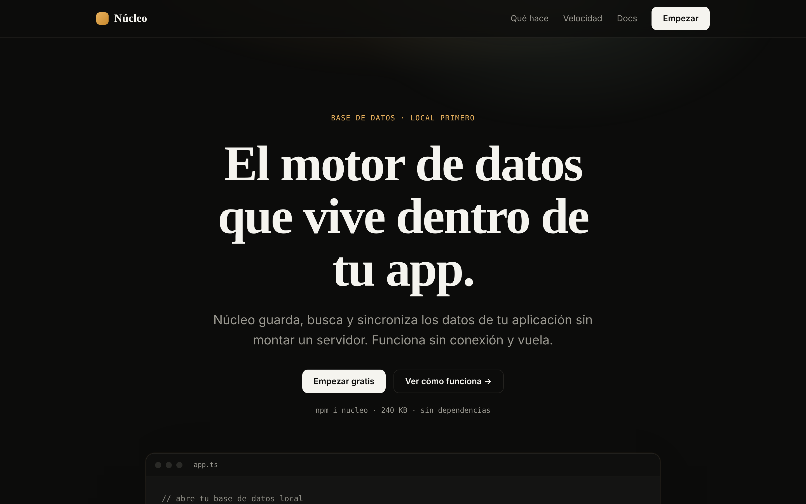
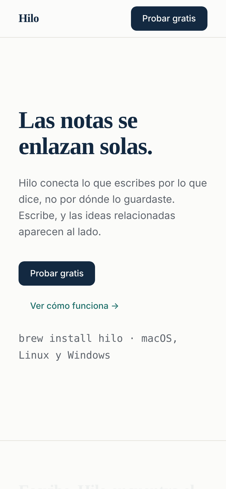

<div align="center">


### Gusto de diseño para agentes de código

Folio hace que las páginas web se vean **diseñadas con intención**, no genéricas.
No es una plantilla: es un **criterio**.

[](LICENSE)
[](CHANGELOG.md)
[](https://github.com/VemorisSoftware)

</div>

---

Le das a tu agente (Claude Code, Codex…) el gusto para maquetar una página con
una **dirección clara**, jerarquía real y aire, y para **revisar el resultado en
un navegador de verdad** hasta que quede bien. Funciona con HTML puro, React,
Vue, Svelte o Astro: Folio trata del diseño, no del framework.

<div align="center">



<em>Producto / tech: hero oscuro, titular serif enorme, mockup con luz, diagrama y cifras.</em>

<br><br>


<em>Editorial sereno: la misma skill, otra voz. Las dos pasan la revisión en 4 anchos.</em>

</div>

## Instalar

Necesitas **Node 22+** y **Chrome, Edge o Chromium** instalado (para la revisión
en navegador; define `CHROME_PATH` si está en una ruta rara). No se necesitan API
keys ni cuentas.

```sh
# Claude Code / Codex (clona y enlaza; un git pull lo deja al día)
git clone https://github.com/VemorisSoftware/folio
cd folio && npm install && ./install.sh         # --codex o --all-agents
```

Luego, en la carpeta de tu proyecto web, pídele a tu agente:

> «Rediseña la portada con Folio» · «Construye una landing para … usando Folio»

El agente lee `SKILL.md` y sigue el proceso.

## Cómo funciona

Folio le da al agente un proceso de 5 pasos:

1. **Entender** qué es la página y su **tipo** (`producto`, `servicio`, `lugar`, `editorial`, `portafolio`).
2. **Repartir el sistema** — paleta + tipografía coherentes, con contraste AA comprobado.
3. **Elegir una dirección de arte** — una sola, de 14 disponibles.
4. **Construir con contenido real** — nada de relleno ni cajas grises; fotos con licencia libre y crédito.
5. **Revisar y cerrar** — abre la página en 4 anchos, revisa, y no deja pasar una FALLA.

## Las herramientas

Scripts de verdad (Node + Chrome, sin APIs). Un comando: `node scripts/folio.mjs <cmd>`.

| Comando | Qué hace |
|---|---|
| `sistema --tipo <tipo>` | Reparte paleta + tipografía y escribe los `<link>` y tokens `:root`. |
| `direccion --tipo <tipo>` | Reparte una dirección de arte (evita las recientes). |
| `fotos "<búsqueda>"` | Busca imágenes con licencia libre (Openverse) y arma el crédito. |
| `revisar <url\|archivo>` | Abre la página en 4 anchos y revisa desborde, un solo H1, contraste AA, ancho de línea, nº de tipografías, `alt` y toque en móvil. |
| `textos <archivo>` | Linter: caza «Lorem ipsum», frases de molde, testimonios de relleno y marcadores. |
| `cierre <url\|archivo>` | La puerta de cierre: textos + revisión. No pasa con FALLAS. Sirve como hook de Stop. |

## Las 14 direcciones de arte

| | | | |
|---|---|---|---|
| **Editorial sereno** · texto que convence | **Monolito** · una idea potente | **Índice** · listas y estructura | **Terminal** · técnica, para devs |
| **Galería** · varias imágenes | **Dividido** · idea + prueba | **Centrado** · mensaje corto | **Producto** · un objeto o pantalla |
| **Foto** · una imagen manda | **Collage** · piezas con ritmo | **Palabra** · el nombre es el mensaje | **Declaración** · una postura fuerte |
| **Tríptico** · tres cosas iguales | **Panel** · dashboards y apps | | |

<div align="center">

<br>
<em>La misma página en móvil: sin desborde, con la jerarquía intacta.</em>
</div>

## Con tu propia marca

Folio trae un sistema por defecto (cálido, editorial, sobrio), pero **las
direcciones y la revisión valen para cualquier identidad**. Reemplaza los tokens
de color y las dos tipografías por los de tu marca (respetando los roles: un
fondo tranquilo, una voz, un acento con avaricia) y el gusto de Folio se mantiene.
Detalle en `sistema/tokens.md`.

## Preguntas frecuentes

**¿Necesita internet o una cuenta?** No. Solo `folio fotos` usa la red, y únicamente
para buscar imágenes en Openverse. Tu código nunca sale de tu equipo.

**¿Con qué frameworks funciona?** HTML, React, Vue, Svelte, Astro, Tailwind. Folio
trata de diseño, no de framework.

**¿Qué navegador usa la revisión?** El Chrome/Chromium que ya tengas instalado, en
modo headless. Define `CHROME_PATH` si está en una ruta no estándar.

**¿Puede rediseñar una página que ya existe?** Sí: apúntale `folio revisar <url>` y
pídele al agente que arregle lo que salga.

## Filosofía, en tres reglas

1. Una sola idea manda por pantalla.
2. La tipografía hace el trabajo pesado.
3. El color se usa con avaricia.

---

<div align="center">

Software libre (MIT) de **Vemoris Software**. Hecho con cuidado.

</div>
